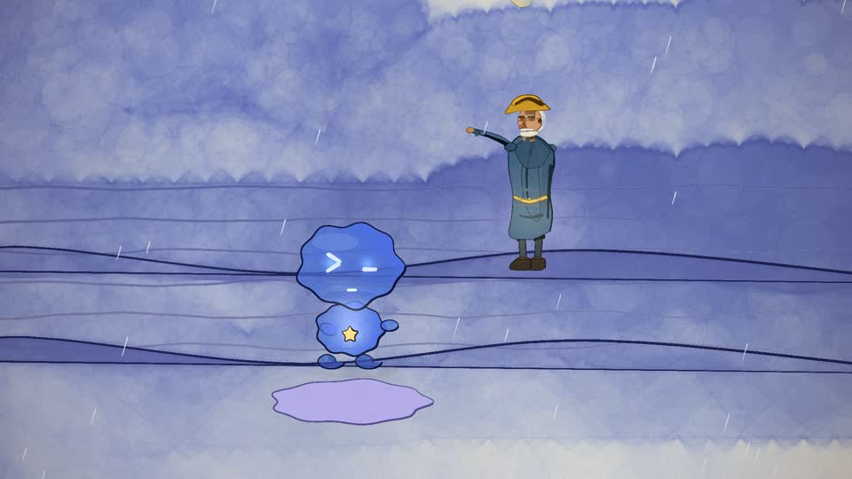

# 《水手》手绘水彩 MV · V5 渲染工程

这是一个 1920×1080 / 24fps / 约 127.8 秒的手绘水彩风格 MV 渲染工程。仓库保存渲染源码、分镜与制作方法，不包含大体积成片和帧序列。


## 效果预览




预览为 `960×540 / 24fps / CRF28`，取自 `01:38–01:58`。完整参数见 [`PREVIEWS.md`](PREVIEWS.md)。

## 目录结构

- `src/`：渲染核心、场景、角色、歌词与时间轴
- `docs/`：角色与动作参考图
- `out/check/`：关键帧与局部 QA 图
- `ANIMATION_GUIDE.md`：动画与画面制作方法
- `STORYBOARD.md`：分镜设计
- `HANDOFF_SHUISHOU_V5.md`：V5 渲染交接说明
- `RENDER_RESULTS.md`：本次成片渲染与校验记录
- `render.mjs`：无头 Chrome 渲染 / 编码入口
- `studio.html`：本地预览入口

## 预览版与生成图

- `docs/preview/shuishou-v5-preview-0138-0158-960x540.mp4`：20 秒结尾梦境/出发段预览，960×540 / 24fps / CRF28。
- `docs/generated/`：26s、37s、45s、54s、103s、110s 六张 960×540 关键帧图。
- `PREVIEWS.md`：预览版参数与重新生成命令。

## 本地预览

```powershell
npm install
```

安装依赖后，用浏览器打开：

```text
studio.html
```

完整渲染需要音频文件位于：

```text
assets/shuishou.m4a
```

出于版权和仓库体积考虑，本仓库不直接附带音频。

## 渲染关键帧 QA

```powershell
node render.mjs --sheet=26,37,45,54,103,110 --cols=3 --w=560 --out=out/check/render_qa_sheet.jpg
```

## 渲染整片帧序列

```powershell
node render.mjs --frames --workers=4
```

## 编码成片

确保 `ffmpeg` 可用后执行：

```powershell
node render.mjs --encode --out=out/video_v5.mp4 --audio=assets/shuishou.m4a
```

成片规格：

- 1920×1080
- 24fps
- 3067 帧
- 约 127.792 秒
- H.264 / CRF17 / slow
- AAC 音频

## 版权与授权说明

- 根目录 `LICENSE` 保留 MIT 许可证与原始版权声明。
- 《水手》相关音频、歌词与成片权利归原权利人所有；未确认授权范围前，不应公开分发。
- 若要公开此仓库，请先确认歌词、音频、最终成片与参考素材的授权范围。